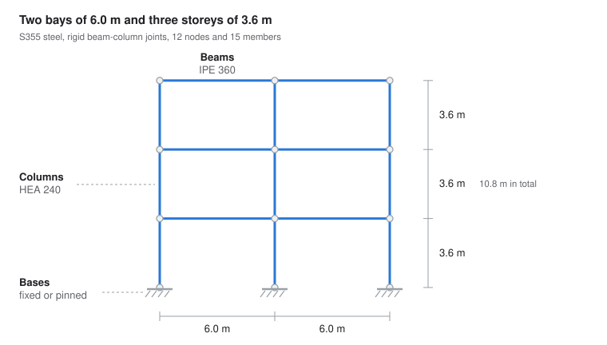
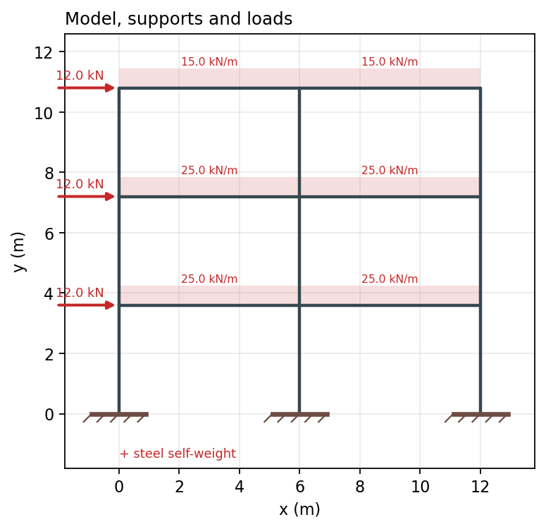
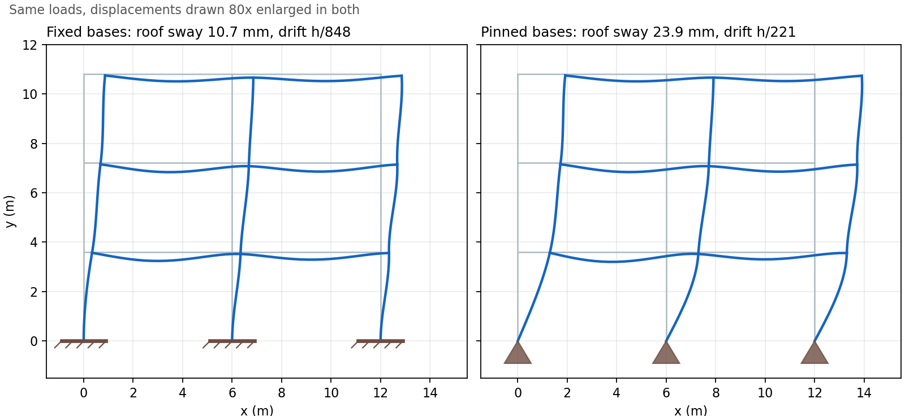
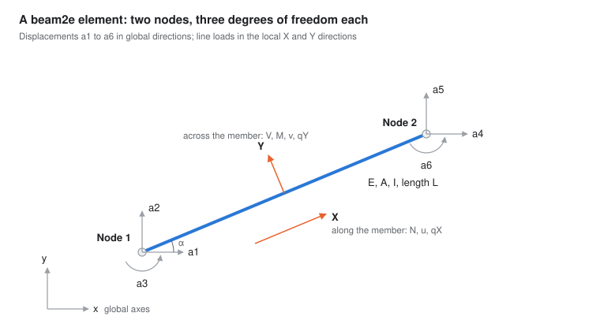
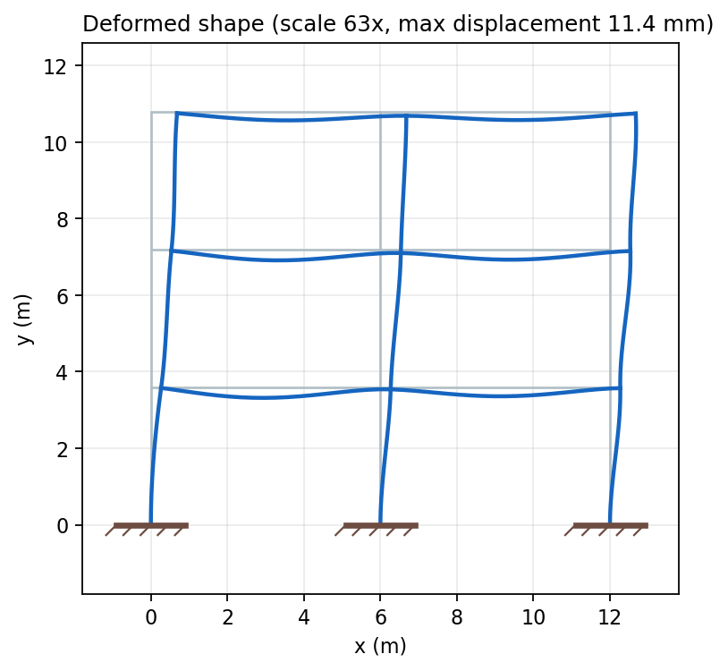
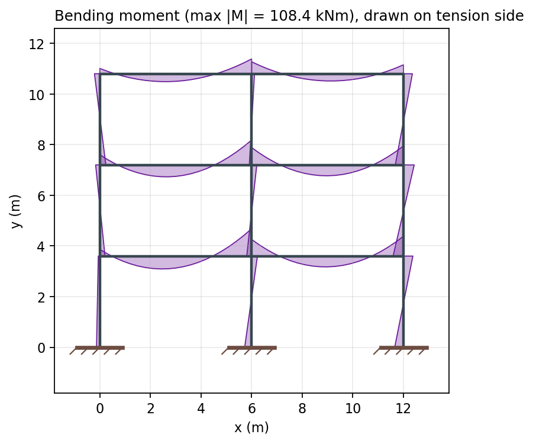

# Steel Frame Example: The Engineering Problem

Jonas Lindemann, 28 October 2026

## The problem

We want to know whether a three-storey, two-bay steel frame is stiff and strong enough for its floor, roof and wind loads. The frame is a planar slice of a small office or school building: steel columns and beams joined by rigid connections, standing on foundations.

An engineer asks four questions of such a frame:

1. How far does the building sway sideways under wind?
2. How much do the floor beams sag?
3. Which members carry the largest forces, and how close are they to yielding?
4. How do the answers change with spans, sections and support conditions?

The frame makes a good teaching example. It is small enough to understand completely, yet it is statically indeterminate, so hand calculation is tedious and a numerical model earns its place. Its building blocks also have exact textbook solutions, so we can prove that the code is right before we trust it.

## Structural system and geometry

The reference frame has 2 bays of 6.0 m and 3 storeys of 3.6 m, giving a 12.0 m wide and 10.8 m tall structure. Columns are HEA 240 and beams are IPE 360, both in S355 steel (E = 210 GPa, fy = 355 MPa). Every parameter can be changed in the application.

| Parameter | Reference value | Range in the app |
| --- | --- | --- |
| Bays × bay width | 2 × 6.0 m | 1–8 × 2–15 m |
| Storeys × storey height | 3 × 3.6 m | 1–15 × 2.5–6 m |
| Columns | HEA 240 | 16 IPE/HEA/HEB sections |
| Beams | IPE 360 | 16 IPE/HEA/HEB sections |
| Steel grade | S355 | S235, S275, S355 |
| Column bases | Fixed | Fixed or pinned |

Each column and each beam is one member between two nodes. Nodes are numbered level by level from the bottom left, so the reference frame has 12 nodes and 15 members: 9 columns and 6 beams.



## Loads

Four load types act on the frame. The program applies them exactly as entered; choosing characteristic or design values, and combining them, is the engineer's decision.

| Load | Reference value | How it is modelled |
| --- | --- | --- |
| Floor load | 25 kN/m | Uniform downward line load on floor beams |
| Roof load | 15 kN/m | Uniform downward line load on roof beams |
| Horizontal (wind) load | 12 kN per floor | Point load at the left column, every floor level |
| Steel self-weight | 7850 kg/m³ × A × g | Downward line load on every member |



Self-weight looks harmless, but it is where a classic mistake hides. On a beam it acts across the member; on a column it acts along it. The model must turn each global load into the member's own (local) directions, which is the subject of the numerical-model section.

## Supports: fixed or pinned bases

The support assumption alone decides whether the reference frame passes the drift check. A fixed base stops the column foot from moving and rotating; a pinned base stops movement but lets the foot rotate freely.

| Result, reference frame | Fixed bases | Pinned bases |
| --- | --- | --- |
| Roof sway | 10.7 mm | 23.9 mm |
| Largest interstorey drift | 4.2 mm = h/848 | 16.3 mm = h/221 |
| Drift check (limit h/300) | OK | Not OK |
| Largest bending moment | 108 kNm | 124 kNm |

With pinned bases, the bottom storey has to resist the wind through frame action alone, so its drift almost quadruples. Nothing in the numerical method can tell which assumption is right: that depends on the real foundation and the anchor bolts, and only the engineer knows it.



## From equations to a numerical model

Each member is an Euler–Bernoulli beam that stretches along its axis and bends across it. For a uniform line load q across the member, the deflection v(x) satisfies

```math
EI \frac{d^4 v}{dx^4} = q_y, \qquad EA \frac{d^2 u}{dx^2} = -q_x
```

CALFEM's beam2e element solves these equations exactly for one member. It has two nodes with three degrees of freedom each: displacement along x, displacement along y, and rotation. The element stiffness matrix Ke and load vector fe are assembled into the global system and solved with the supports applied:



```math
\mathbf{K}\,\mathbf{a} = \mathbf{f}, \qquad \mathbf{r} = \mathbf{K}\,\mathbf{a} - \mathbf{f}
```

where a holds the node displacements and r the support reactions. Because the element is exact for uniform loads, one element per member gives the exact solution; no mesh refinement is needed.

The element expects its line load in local directions: q<sub>X</sub> along the member and q<sub>Y</sub> across it. A load given in global directions (q<sub>x</sub>, q<sub>y</sub>) is transformed with the member's direction cosines c = cos α and s = sin α:

```math
q_X = c\,q_x + s\,q_y, \qquad q_Y = -s\,q_x + c\,q_y
```

For a beam pointing right (α = 0) the transform changes nothing, which is why skipping it looks fine at first. For a column (α = 90°) the downward self-weight becomes an axial load. Skip the transform and that self-weight pushes the columns sideways instead, increasing the roof sway by 43 %.

## What we compute

The solution gives the displacement of every node and, from it, the exact fields along every member: axial displacement u, transverse displacement v, normal force N, shear force V and bending moment M. The reference frame solves in a few milliseconds, which is fast enough to update the plots while a slider moves.

Two pictures carry most of the engineering meaning:

- **Deformed shape.** Displacements are millimetres on a 12 m frame, so the plot is enlarged. The enlargement factor and the real maximum displacement are always printed beside it, because an automatically scaled plot looks the same whether the frame moves 1 mm or 1 m.
- **Bending moment diagram.** Moments are drawn on the tension side of each member. Floor beams sag between columns (tension at the bottom) and hog over the columns (tension at the top). The largest moment, 108 kNm, sits over the inner column at the first floor.

The figures below come straight from the verified model of the reference frame with fixed bases.





## Engineering checks

The reference frame with fixed bases passes all three checks, with its largest utilisation at 34 % in a first-floor beam.

| Check | Measure | Limit | Reference frame, fixed bases |
| --- | --- | --- | --- |
| Interstorey drift | Largest relative sway of two floors, divided by storey height | h/300 | h/848, OK |
| Beam deflection | Largest sag relative to the beam ends, divided by span | L/250 | L/1562, OK |
| Elastic utilisation | (\|N\|/A + \|M\|/W) / fy, largest along each member | 100 % | 34 %, OK |

The limits are typical serviceability values, not taken from a specific code. Utilisation is an elastic stress ratio, so it is a first indication, not a design check: buckling of the columns and lateral-torsional buckling of the beams are not included.

## Verification

All 21 analytical benchmark values match to round-off, and the reference frame is in equilibrium to about 1e-16. We trust the model because three independent kinds of evidence agree.

**Analytical benchmarks.** Small models with textbook answers, run through the same code as the building frame:

| Case | Quantity | Textbook value |
| --- | --- | --- |
| Cantilever, tip load P | Tip deflection | PL³ / 3EI |
| Cantilever, uniform load q | Tip deflection | qL⁴ / 8EI |
| Simply supported beam, uniform load | Midspan deflection | 5qL⁴ / 384EI |
| Same beam, defined right to left | Midspan deflection | 5qL⁴ / 384EI |
| Fixed–fixed beam, uniform load | End moment | qL² / 12 |
| Column under its own weight | Top shortening | qH² / 2EA |
| Portal frame, fixed bases, rigid beam | Sway under H | Hh³ / 24EI |
| Portal frame, pinned bases, rigid beam | Sway under H | Hh³ / 6EI |

**Physical properties.** Rules that hold for any frame, including ones with no textbook answer: reactions balance the applied loads (computed independently of K), symmetric loads give symmetric deformation, results superpose, and self-weight reactions equal the steel weight.

**Data checks.** Benchmarks use their own section values, so they cannot see a bad section table. A separate test checks that 2I/W gives the real profile depth and that the mass per metre is realistic. This catches the cm⁴-versus-cm² unit slip, which otherwise makes every deflection look 10 000 times too small and every check pass.

## Assumptions, limitations and ownership

The model is a teaching example, not a design tool. Its assumptions:

- Linear elastic, first-order analysis: no P-delta effects, no buckling, no lateral-torsional buckling.
- Euler–Bernoulli beams with axial deformation; shear deformation is neglected.
- Rigid beam–column connections; column bases either fully fixed or pinned.
- Loads applied as entered, with no partial factors or load combinations.
- Nominal section properties for strong-axis bending, to be checked against supplier tables.

The work splits along one line: the engineer owns the model and its validation; AI helps build the application around it.

| Part | Owner | Contents |
| --- | --- | --- |
| Section data | Engineer | Profiles, steel grades, unit conversions |
| Computational core | Engineer | Geometry, supports, loads, CALFEM assembly and solution |
| Verification | Engineer | Benchmarks, physical-property tests, data checks |
| Web application | AI-assisted | Inputs, plots, check cards, verification tab |
| Calculation report | AI-assisted | Input echo, figures, tables, sign-off |

The application only presents what the core computes. Even so, it can mislead: a mistyped option that silently turns "pinned" into "fixed" passes every automated check. That is why the app and the report repeat the inputs exactly as the model received them.
